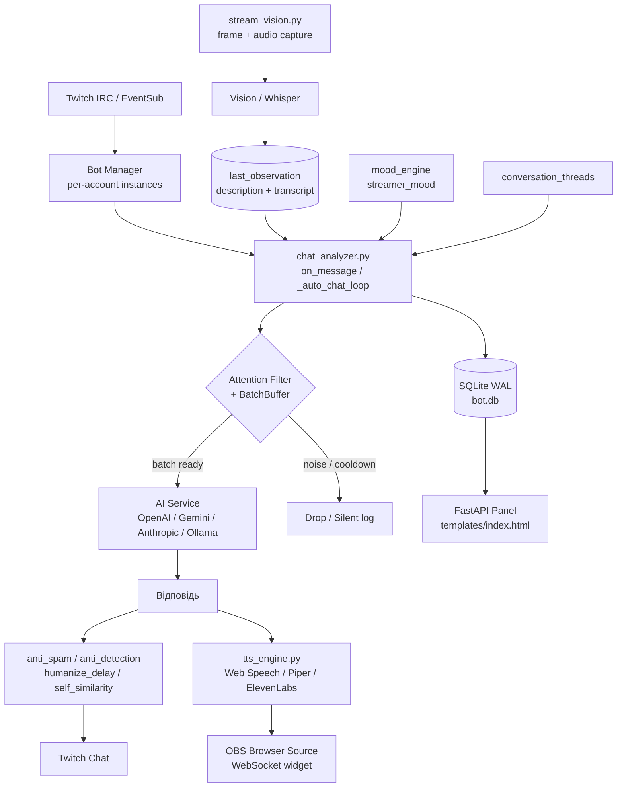
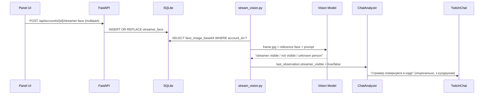
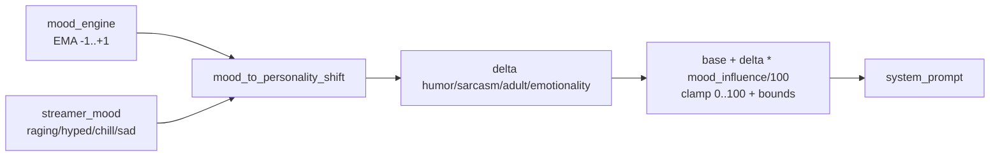
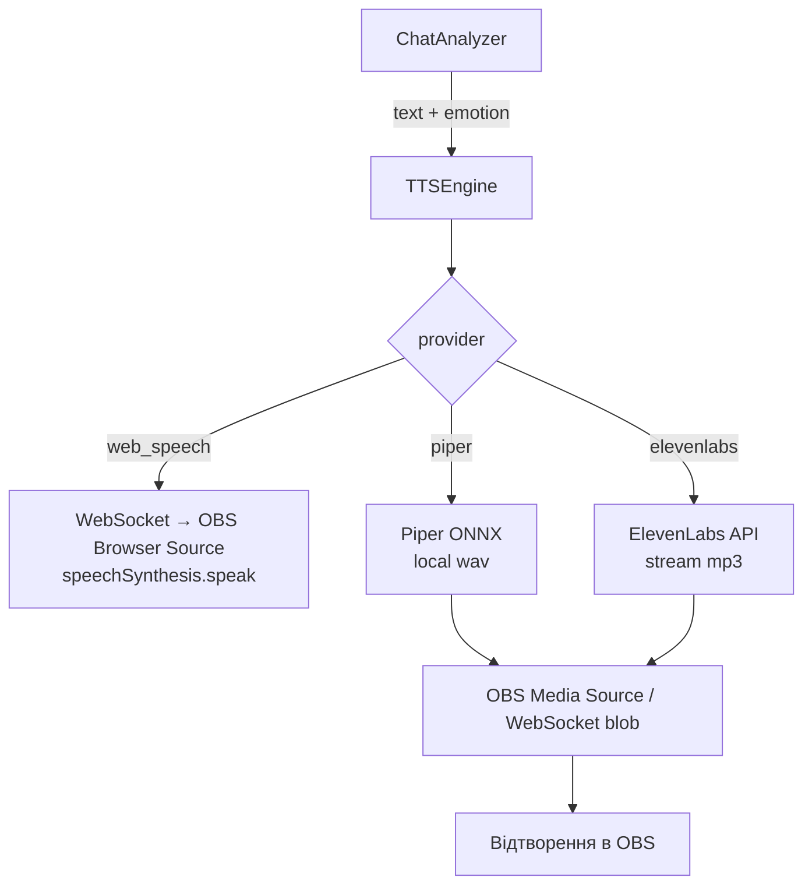
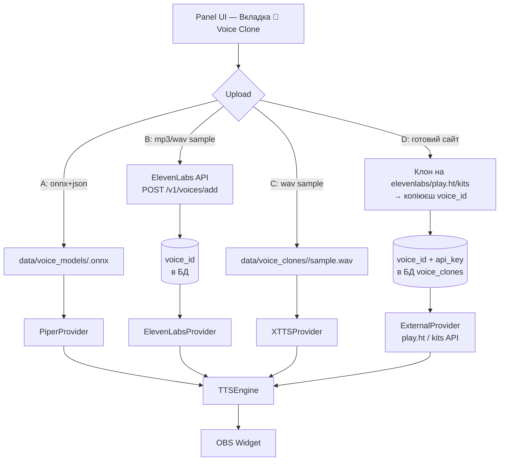
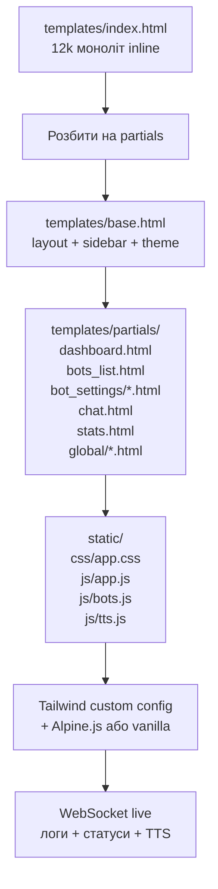
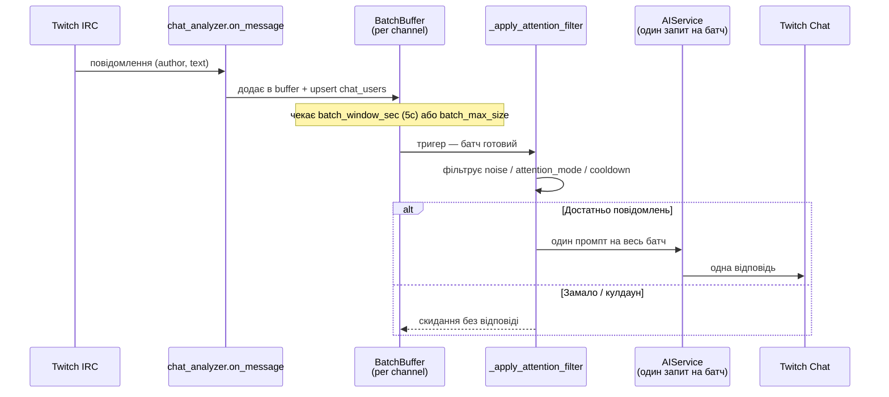

# Twitch AI Bot v11 — План реформування (Extended v11.1)

> **Статус:** `draft` · **Дата:** 2026-08-26 · **База:** v10.5 + інкременти v10.4.x  
> **Мета:** Перетворити бота з "розумного чаттера" в керовану AI-платформу: персистентна пам'ять, керований характер, TTS через OBS, масштабований UI та надійний батчинг.

---

## Зміст
- [0. Архітектура v11 — огляд](#0-архітектура-v11--огляд)
- [БЛОК 1: Нова БД стрімера + пам'ять ботів](#блок-1-нова-бд-стрімера--память-ботів)
- [БЛОК 2: Розширена персона + "режим людини"](#блок-2-розширена-персона--режим-людини)
- [БЛОК 3: Озвучування через OBS (TTS)](#блок-3-озвучування-через-obs-tts)
- [БЛОК 4: Повний редизайн панелі (UI redesign)](#блок-4-повний-редизайн-панелі-ui-redesign)
- [БЛОК 5: Окремі API/моделі per-bot + контекст](#блок-5-окремі-apimоделі-per-bot--контекст)
- [БЛОК 6: Спостереження + "режим тихого бота"](#блок-6-спостереження--режим-тихого-бота)
- [БЛОК 7: Фільтр уваги + батчинг](#блок-7-фільтр-уваги--батчинг-повідомлень-fix-over-triggering)
- [БЛОК 8: Розділення логів per-bot](#блок-8-розділення-логів-per-bot)
- [БЛОК 9: Структура папок per-bot (промпти, файли, конфіги)](#блок-9-структура-папок-per-bot-промпти-файли-конфіги)
- [Порядок реалізації](#порядок-реалізації)
- [Технічні деталі](#технічні-деталі)
- [Додаток A: Зведений API v11](#додаток-a-зведений-api-v11)
- [Додаток B: Дизайн-система — токени та компоненти](#додаток-b-дизайн-система--токени-та-компоненти)
- [Додаток C: Міграція та ризики](#додаток-c-міграція-та-ризики)

---

## 0. Архітектура v11 — огляд

### 0.1 Діаграма потоку даних



### 0.2 Принципи v11
1. **Батчинг замість спаму** — один AI-виклик на батч, а не на кожне повідомлення.
2. **Per-bot ізоляція** — пам'ять, логи, TTS, AI-оверрайди не течуть між ботами.
3. **Прогресивна деградація** — якщо ElevenLabs недоступний → Piper → Web Speech.
4. **Мобільний перший UI** — керування з телефона стрімера без горизонтального скролу.
5. **Міграції без дропів** — тільки `CREATE IF NOT EXISTS` + `_add_column_if_missing`.

---

## БЛОК 1: Нова БД стрімера + пам'ять ботів

### Нові таблиці (призначення)

| Таблиця | Призначення |
|---|---|
| `streamer_profile` | Факти про стрімера: вік, інтереси, ігри, стиль, що любить/не любить. AI сам заповнює + ручне редагування |
| `streamer_face` | Фото обличчя стримера (base64/blob) для візіон-моделей. Бот розпізнає стримера на кадрах |
| `streamer_events` | Хроніка подій: дати стримів, рейди, донати, важливі моменти |
| `streamer_stats` | Агрегована статистика: онлайн/офлайн, глядачі, топ-чатери, середня тривалість |
| `bot_conversation_history` | Персистентна пам'ять: кожне повідомлення + відповідь з таймстемпом |
| `bot_streamer_affinity` | Рівень прив'язаності бота до стрімера/чату (авто + ручне) |
| `channel_overrides` | Per-channel перезаписи параметрів бота (humor, sarcasm, adult, attention тощо) |
| `voice_speakers` | Розпізнані голоси на стримі: стример, модер, глядач — з прив'язкою до channel |
| `raid_context_log` | Збережений контекст raid-сесій: хто рейдив, що писали, як довго |
| `shared_chatter_facts` | Спільні факти про користувачів між ботами (посилення пам'яті) |

### 1.1 SQL — створення та індекси

```sql
-- Профіль стрімера (1 row per account)
CREATE TABLE IF NOT EXISTS streamer_profile (
    account_id   INTEGER PRIMARY KEY,
    age          INTEGER DEFAULT 0,
    gender       TEXT DEFAULT '',
    location     TEXT DEFAULT '',
    occupation   TEXT DEFAULT '',
    bio          TEXT DEFAULT '',
    interests    TEXT DEFAULT '[]',   -- JSON array
    favorite_games TEXT DEFAULT '[]', -- JSON array
    streaming_style TEXT DEFAULT '',  -- educational / entertaining / competitive
    likes        TEXT DEFAULT '[]',
    dislikes     TEXT DEFAULT '[]',
    auto_updated INTEGER DEFAULT 1,
    created_at   TIMESTAMP DEFAULT CURRENT_TIMESTAMP,
    updated_at   TIMESTAMP DEFAULT CURRENT_TIMESTAMP,
    FOREIGN KEY (account_id) REFERENCES accounts(id) ON DELETE CASCADE
);

-- Фото обличчя (base64, до 2MB — валідувати в API)
CREATE TABLE IF NOT EXISTS streamer_face (
    account_id INTEGER PRIMARY KEY,
    face_image_base64 TEXT NOT NULL DEFAULT '',
    mime_type  TEXT NOT NULL DEFAULT 'image/jpeg',
    updated_at TIMESTAMP DEFAULT CURRENT_TIMESTAMP,
    FOREIGN KEY (account_id) REFERENCES accounts(id) ON DELETE CASCADE
);

CREATE TABLE IF NOT EXISTS streamer_events (
    id         INTEGER PRIMARY KEY AUTOINCREMENT,
    account_id INTEGER NOT NULL,
    channel    TEXT NOT NULL DEFAULT '',
    event_type TEXT NOT NULL, -- stream_start / raid / donation / clip / highlight
    data_json  TEXT NOT NULL DEFAULT '{}',
    created_at TIMESTAMP DEFAULT CURRENT_TIMESTAMP,
    FOREIGN KEY (account_id) REFERENCES accounts(id) ON DELETE CASCADE
);
CREATE INDEX IF NOT EXISTS idx_streamer_events_acc_time ON streamer_events(account_id, created_at);

CREATE TABLE IF NOT EXISTS streamer_stats (
    account_id INTEGER PRIMARY KEY,
    total_streams INTEGER DEFAULT 0,
    total_messages INTEGER DEFAULT 0,
    avg_viewers  REAL DEFAULT 0,
    top_chatters TEXT DEFAULT '[]', -- JSON [{username, count}]
    updated_at   TIMESTAMP DEFAULT CURRENT_TIMESTAMP,
    FOREIGN KEY (account_id) REFERENCES accounts(id) ON DELETE CASCADE
);

CREATE TABLE IF NOT EXISTS bot_conversation_history (
    id         INTEGER PRIMARY KEY AUTOINCREMENT,
    account_id INTEGER NOT NULL,
    channel    TEXT NOT NULL,
    role       TEXT NOT NULL CHECK(role IN ('user','assistant','system')),
    author     TEXT NOT NULL DEFAULT '',
    content    TEXT NOT NULL,
    metadata_json TEXT DEFAULT '{}',
    created_at TIMESTAMP DEFAULT CURRENT_TIMESTAMP,
    FOREIGN KEY (account_id) REFERENCES accounts(id) ON DELETE CASCADE
);
CREATE INDEX IF NOT EXISTS idx_bch_acc_chan_time ON bot_conversation_history(account_id, channel, created_at);
CREATE INDEX IF NOT EXISTS idx_bch_role ON bot_conversation_history(role);

CREATE TABLE IF NOT EXISTS bot_streamer_affinity (
    account_id   INTEGER PRIMARY KEY,
    contact_level INTEGER DEFAULT 50 CHECK(contact_level BETWEEN 0 AND 100),
    chat_affinity INTEGER DEFAULT 50 CHECK(chat_affinity BETWEEN 0 AND 100),
    auto_adjust  INTEGER DEFAULT 0,
    updated_at   TIMESTAMP DEFAULT CURRENT_TIMESTAMP,
    FOREIGN KEY (account_id) REFERENCES accounts(id) ON DELETE CASCADE
);

CREATE TABLE IF NOT EXISTS channel_overrides (
    id             INTEGER PRIMARY KEY AUTOINCREMENT,
    account_id     INTEGER NOT NULL,
    channel        TEXT NOT NULL,
    overrides_json TEXT NOT NULL DEFAULT '{}',
    enabled        INTEGER DEFAULT 1,
    updated_at     TIMESTAMP DEFAULT CURRENT_TIMESTAMP,
    FOREIGN KEY (account_id) REFERENCES accounts(id) ON DELETE CASCADE,
    UNIQUE(account_id, channel)
);
CREATE INDEX IF NOT EXISTS idx_ch_ov_acc ON channel_overrides(account_id, enabled);

-- Голоси (speaker diarization per channel)
CREATE TABLE IF NOT EXISTS voice_speakers (
    id          INTEGER PRIMARY KEY AUTOINCREMENT,
    account_id  INTEGER NOT NULL,
    channel     TEXT NOT NULL,
    speaker_id  TEXT NOT NULL,        -- 'streamer' | 'mod_xxx' | 'viewer_xxx' | 'unknown'
    display_name TEXT NOT NULL DEFAULT '',
    voice_profile TEXT NOT NULL DEFAULT '{}',  -- JSON: pitch range, speed, tone
    is_streamer INTEGER DEFAULT 0,
    sample_count INTEGER DEFAULT 0,
    last_seen   TIMESTAMP DEFAULT CURRENT_TIMESTAMP,
    FOREIGN KEY (account_id) REFERENCES accounts(id) ON DELETE CASCADE,
    UNIQUE(account_id, channel, speaker_id)
);
CREATE INDEX IF NOT EXISTS idx_vs_acc_chan ON voice_speakers(account_id, channel);

-- Raid context log
CREATE TABLE IF NOT EXISTS raid_context_log (
    id              INTEGER PRIMARY KEY AUTOINCREMENT,
    account_id      INTEGER NOT NULL,
    raid_from       TEXT NOT NULL,
    raid_to         TEXT NOT NULL,
    duration_sec    INTEGER NOT NULL DEFAULT 0,
    messages_sent   INTEGER NOT NULL DEFAULT 0,
    context_summary TEXT NOT NULL DEFAULT '',  -- AI-згенерований переказ raid
    started_at      TIMESTAMP DEFAULT CURRENT_TIMESTAMP,
    ended_at        TIMESTAMP,
    FOREIGN KEY (account_id) REFERENCES accounts(id) ON DELETE CASCADE
);
CREATE INDEX IF NOT EXISTS idx_rcl_acc ON raid_context_log(account_id, started_at);

-- Спільні факти про користувачів (між ботами)
CREATE TABLE IF NOT EXISTS shared_chatter_facts (
    id          INTEGER PRIMARY KEY AUTOINCREMENT,
    channel     TEXT NOT NULL,
    username    TEXT NOT NULL,
    fact        TEXT NOT NULL,
    source_bot  INTEGER NOT NULL,   -- account_id бота який знайшов цей факт
    confidence  REAL DEFAULT 0.5,   -- наскільки впевнені (0-1)
    created_at  TIMESTAMP DEFAULT CURRENT_TIMESTAMP,
    updated_at  TIMESTAMP DEFAULT CURRENT_TIMESTAMP,
    UNIQUE(channel, username, fact)
);
CREATE INDEX IF NOT EXISTS idx_scf_chan_user ON shared_chatter_facts(channel, username);
```

### 1.2 Міграція (існуючий патерн)

```python
# app/database.py — в кінці init_db()
await db.executescript(""" CREATE TABLE IF NOT EXISTS streamer_profile (...) ... """)
await _add_column_if_missing(db, "streamer_profile", "auto_updated", "INTEGER DEFAULT 1")
# для face — без ALTER, тільки CREATE IF NOT EXISTS (blob окремо)
```

> **Ліміти:** `face_image_base64` — max 2MB після base64, валідувати `Content-Length` в route. Зберігати як TEXT, не BLOB — простіше для JSON-бекапів.

### 1.3 Візіон: фото стримера для розпізнавання

**Флоу:**


**API:**
| Метод | Шлях | Тіло / Відповідь |
|---|---|---|
| `POST` | `/api/accounts/{id}/streamer-face` | `multipart/form-data: file` → `{ok, mime_type, size}` |
| `GET` | `/api/accounts/{id}/streamer-face` | → `{ok, has_face, mime_type, updated_at, image_base64?}` (base64 тільки якщо `?include=1`) |
| `DELETE` | `/api/accounts/{id}/streamer-face` | → `{ok}` |

**Інтеграція з `stream_vision.py`:**
```python
# app/stream_vision.py — псевдокод
async def _build_vision_prompt_with_reference(account_id: int, channel: str) -> list[dict]:
    ref = await get_streamer_face(account_id)  # base64 або None
    base_prompt = get_vision_prompt_style()     # basic / detailed / override
    if ref:
        return [
            {"role": "user", "content": [
                {"type": "text", "text": base_prompt + "\nДодатково: порівняй обличчя на кадрі з reference фото стримера."},
                {"type": "image_url", "image_url": {"url": f"data:{ref['mime_type']};base64,{ref['b64']}"}},
                {"type": "image_url", "image_url": {"url": f"data:image/jpeg;base64,{frame_b64}"}},
            ]}
        ]
    return [{"role": "user", "content": [{"type": "text", "text": base_prompt}, {"type": "image_url", "image_url": {"url": f"data:image/jpeg;base64,{frame_b64}"}}]}]
```
Підтримується для провайдерів з vision: `openai` (gpt-4o), `gemini`, `anthropic` (claude-3.5). Для `ollama` — skip, якщо модель без vision.

### 1.4 `streamer_profile.py` — авто-заповнення

```python
# app/streamer_profile.py
async def auto_update_profile(account_id: int, channel: str, chat_sample: list[dict]) -> dict:
    """Раз на N хвилин збирає факти з чату + Helix channel_info -> LLM extraction -> upsert."""
    info = await get_channel_info(channel)  # Helix: game_name, title, tags
    prompt = f"Виділи факти про стримера з чату та Helix: {info} + {chat_sample[:20]}. Поверни JSON {{age, interests, likes, dislikes}}"
    facts = await ai_service.extract_json(prompt, account_id=account_id)
    await upsert_streamer_profile(account_id, facts)
    return facts
```

---

## БЛОК 2: Розширена персона + "режим людини"

### 2.1 Розширення `BotPersona` (нові поля)

| Поле | Тип | Опис | Default |
|---|---|---|---|
| `humor_level` | int 0-100 | Рівень гумору | 50 |
| `darkness_level` | int 0-100 | Чорний гумор | 10 |
| `crudeness_level` | int 0-100 | Пошлості, мати, жорсткість | 0 |
| `seriousness` | int 0-100 | Серйозність (0=тільки жарти, 100=ніколи не жартує) | 50 |
| `sarcasm_level` | int 0-100 | Сарказм | 30 |
| `emotionality` | int 0-100 | Емоційність | 50 |
| `adult_humor` | int 0-100 | Інтимний/вульгарний гумор | 0 |
| `*_enabled` (bool per метрика) | bool | Тогл "AI вирішує" — якщо false, AI сам обирає рівень | true (всі увімкнені) |
| `asterisk_emotes` | bool | `*обиженно смотрит*` | false |
| `observation_only` | bool | Тільки спостерігає, не пише | false |
| `contact_level` | int 0-100 | Прив'язаність до стрімера | 50 |
| `chat_affinity` | int 0-100 | Прив'язаність до чату | 50 |
| `auto_adjust_contact` | bool | Авто-налаштування контакту | false |
| `dynamic_personality` | bool | Сам змінює параметри під ситуацію | false |
| `mood_influence` | int 0-100 | Наскільки настрій чату впливає | 0 |
| `min_humor` / `max_humor` ... | int 0-100 | Кордони для динаміки (опціонально, per-метрика) | 0 / 100 |
| `channel_overrides` | JSON | Per-channel перезапис деяких параметрів (див. нижче) | `{}` |
| `*_enabled` (bool per метрика) | bool | Тогл "AI вирішує" — якщо false, AI сам обирає рівень | true (всі увімкнені) |

### Кнопка "AI вирішує" для кожної емоції:

Кожна метрика (humor, sarcasm, darkness, crudeness, adult, emotionality, seriousness) має:
- **Слайдер 0-100** — ручне значення
- **Тогл "AI вирішує"** — вимикає слайдер, AI сам обирає рівень залежно від контексту

**Як працює:**
```
humor_enabled = true  → використовує humor_level=60
humor_enabled = false → AI сам вирішує рівень гумору

darkness_enabled = true  → darkness_level=30
darkness_enabled = false → AI сам вирішує

adult_enabled = true  → adult_humor=50
adult_enabled = false → AI сам вирішує (але ніколи не вище за bounds)
```

**UI:**
```
幽默 [===========-----] 60  [🤖 AI вирішує]  ← тогл поруч зі слайдером
```

**Комбінація:** гумор=фіксований 60, сарказм=AI вирішує, доросле=фіксоване 0

### Per-channel адаптація (не повна, тільки ключові параметри):

**Що може перезаписуватися per-channel:**

| Параметр | Як адаптується |
|---|---|
| `humor_level` | ±20 від базового |
| `sarcasm_level` | ±20 |
| `adult_humor` | ±30 (на дитячому каналі = 0) |
| `contact_level` | ±30 |
| `observation_only` | on/off (на одному каналі спостерігає, на іншому пише) |
| `attention_mode` | per-channel |
| `cooldown_after_reply_sec` | ±15 сек |
| `max_replies_per_minute` | ±2 |

**Що НЕ перезаписується (завжди per-account):** AI ключ, TTS голос, персона (ім'я, вік, біографія).

**Приклад:**
```
Базові: humor=60, sarcasm=40
#chill_stream overrides: humor=-15, sarcasm=-10 → humor=45, sarcasm=30
#hype_stream overrides: humor=+20, sarcasm=+15 → humor=80, sarcasm=55
```

**Код — `app/bot_persona.py`:**
```python
@dataclass
class BotPersona:
    # ... існуючі поля name/age/gender/personality/... (v10.4.4)
    humor_level: int = 50
    darkness_level: int = 10
    crudeness_level: int = 0
    seriousness: int = 50
    sarcasm_level: int = 30
    emotionality: int = 50
    adult_humor: int = 0
    asterisk_emotes: bool = False
    observation_only: bool = False
    contact_level: int = 50
    chat_affinity: int = 50
    auto_adjust_contact: bool = False
    dynamic_personality: bool = False
    mood_influence: int = 0
    # Тогли "AI вирішує" — якщо false, AI сам обирає рівень
    humor_enabled: bool = True
    sarcasm_enabled: bool = True
    darkness_enabled: bool = True
    crudeness_enabled: bool = True
    adult_enabled: bool = True
    emotionality_enabled: bool = True
    seriousness_enabled: bool = True
    # кордони — dict або окремі поля
    bounds: dict[str, tuple[int,int]] = field(default_factory=dict)  # e.g. {"humor": (30,80)}

    def clamp(self) -> None:
        for f in ("humor_level","darkness_level","crudeness_level","seriousness","sarcasm_level","emotionality","adult_humor","contact_level","chat_affinity"):
            v = getattr(self, f)
            lo, hi = self.bounds.get(f.replace("_level",""), (0,100))
            setattr(self, f, max(lo, min(hi, int(v))))

def format_extended_persona_for_prompt(p: BotPersona) -> str:
    base = format_persona_for_prompt(p)  # існуючий блок [Твоя личность]
    if p.is_empty() and not p.dynamic_personality:
        return base
    extra = [f"[Характер] гумор={p.humor_level} сарказм={p.sarcasm_level} серйозність={p.seriousness} "
             f"емоційність={p.emotionality} adult={p.adult_humor} darkness={p.darkness_level}"]
    if p.asterisk_emotes:
        extra.append("Можеш використовувати *дії* типу *смущенно отводит взгляд*.")
    return base + "\n" + "\n".join(extra) if base else "\n".join(extra)
```

### 2.2 Динамічна особистість (auto-adapt)

**Ідея:** `mood_engine` (EMA чату) + `streamer_mood` → дельти до базових метрик, зважені на `mood_influence`.



**Маппінг настрою → дельти:**

| Настрій чату | Гумор | Сарказм | Доросле | Емоційність | Серйозність |
|---|---|---|---|---|---|
| 😊 Весело | +20 | +10 | +15 | +20 | -10 |
| 😐 Нейтрально | ±0 | ±0 | ±0 | ±0 | ±0 |
| 😠 Токсично | -30 | -20 | -40 | -30 | +20 |
| 😢 Сумно | -10 | -10 | -20 | +10 | +10 |
| 🔥 Дико | +30 | +20 | +30 | +30 | -20 |

**Код:**
```python
MOOD_DELTA = {
    "positive": {"humor_level": +20, "sarcasm_level": +10, "adult_humor": +15, "emotionality": +20, "seriousness": -10},
    "toxic":    {"humor_level": -30, "sarcasm_level": -20, "adult_humor": -40, "emotionality": -30, "seriousness": +20},
    # ...
}
def apply_dynamic_persona(base: BotPersona, mood_label: str, streamer_label: str) -> BotPersona:
    if not base.dynamic_personality or base.mood_influence == 0:
        return base
    deltas = MOOD_DELTA.get(mood_label, {})
    w = base.mood_influence / 100.0
    out = copy.deepcopy(base)
    for k, d in deltas.items():
        setattr(out, k, int(getattr(out, k) + d * w))
    out.clamp()
    return out
```

**Обмеження:**
- Ніколи не виходить за [0,100] + per-метрика bounds (`min_humor`/`max_humor`).
- `mood_influence=0` → ігнор настрою, фіксовані значення.
- Динаміка тільки в `chat_analyzer` при збірці промпту, не пише в `persona_json`.

### 2.3 API для ручного зміщення

```
POST /api/accounts/{id}/personality-shift
Body: { "humor_delta": +10, "sarcasm_delta": -5, "duration_sec": 300 }
→ { ok, expires_at, shifted_persona }

Реалізація: in-memory dict _persona_shifts[(account_id)] = (expires_at, deltas)
При format_extended_persona_for_prompt — додати shift якщо не expired.
```

### 2.4 Готові пресети

| Пресет | humor | darkness | crudeness | sarcasm | adult | seriousness | contact | Опис |
|---|---|---|---|---|---|---|---|---|
| **Новачок** | 30 | 10 | 0 | 20 | 0 | 50 | 20 | Тихий, обережний |
| **Друг** | 60 | 30 | 20 | 40 | 30 | 40 | 70 | Добрий, підтримує |
| **Тролль** | 80 | 50 | 40 | 80 | 50 | 20 | 40 | Підколює, провокує |
| **Мудрець** | 40 | 20 | 0 | 60 | 10 | 80 | 60 | Поради + підкол |
| **Токсик** | 70 | 80 | 80 | 90 | 80 | 10 | 20 | Жорсткий, без фільтрів |
| **Спокійний** | 20 | 10 | 0 | 10 | 0 | 50 | 50 | Рівний тон |
| **Дикий** | 90 | 70 | 70 | 85 | 90 | 5 | 30 | Без кордонів |
| **AI-генерація** | — | — | — | — | — | — | — | Опис → AI генерує всі поля |

```python
# app/bot_presets.py
PRESETS: dict[str, dict] = {
    "newbie": {"label": "Новачок", "humor_level": 30, "darkness_level": 10, ...},
    ...
}
async def generate_persona_via_ai(description: str, account_id: int) -> BotPersona:
    prompt = f"Опис персонажа: {description}\nПоверни JSON з полями BotPersona + system_prompt (до 800 символів)."
    raw = await ai_service.generate_json(prompt, account_id=account_id)
    return BotPersona.from_dict(raw)

# Route
# POST /api/accounts/{id}/generate-persona  Body: {description: str} → {ok, persona}
# POST /api/accounts/{id}/persona/apply-preset Body: {preset_id} → {ok, persona}
```

---

## БЛОК 3: Озвучування через OBS (TTS)

### 3.1 3 TTS-провайдери (per-bot вибір)

| Провайдер | Ціна | Якість | Мови | Залежності |
|---|---|---|---|---|
| **Web Speech API** | Безкоштовно | Проста (браузер) | Багато | Немає (Browser Source) |
| **Piper TTS** | Безкоштовно (локально) | Середня | RU/EN (+ONNX) | `piper-tts`, моделі `.onnx` |
| **ElevenLabs API** | ~$5/міс | Висока | Багато | `elevenlabs` SDK, API key |

### 3.2 Нові таблиці

```sql
CREATE TABLE IF NOT EXISTS tts_settings (
    id INTEGER PRIMARY KEY CHECK(id=1),
    provider TEXT DEFAULT 'web_speech' CHECK(provider IN ('web_speech','piper','elevenlabs')),
    voice     TEXT DEFAULT '',
    speed     REAL DEFAULT 1.0,
    volume    REAL DEFAULT 1.0,
    updated_at TIMESTAMP DEFAULT CURRENT_TIMESTAMP
);
CREATE TABLE IF NOT EXISTS tts_bot_config (
    account_id INTEGER PRIMARY KEY,
    provider TEXT DEFAULT '' CHECK(provider IN ('','web_speech','piper','elevenlabs')), -- '' = наслідувати глобальний
    voice     TEXT DEFAULT '',
    emotion_preset TEXT DEFAULT 'neutral',
    volume    REAL DEFAULT 1.0,
    enabled   INTEGER DEFAULT 0,
    FOREIGN KEY (account_id) REFERENCES accounts(id) ON DELETE CASCADE
);
CREATE TABLE IF NOT EXISTS tts_voice_presets (
    id INTEGER PRIMARY KEY AUTOINCREMENT,
    provider TEXT NOT NULL,
    voice_id TEXT NOT NULL,
    label    TEXT NOT NULL,
    lang     TEXT DEFAULT 'ru',
    emotion  TEXT DEFAULT 'neutral', -- neutral / angry / sad / happy / surprised / fear
    UNIQUE(provider, voice_id)
);
-- seed: записати дефолтні голоси Piper (ru_RU, en_US) + ElevenLabs (Rachel, Adam...)
```

### 3.3 Архітектура — інтерфейс `tts_engine.py`



```python
# app/tts_engine.py — скелет
class TTSProvider(Protocol):
    async def synthesize(self, text: str, voice: str, emotion: str, speed: float) -> bytes: ...

class WebSpeechProvider:
    async def synthesize(self, text, voice, emotion, speed) -> bytes:
        # Не синтезує на сервері — повертає JSON для Browser Source, який викличе speechSynthesis
        return json.dumps({"mode": "web_speech", "text": text, "voice": voice, "rate": speed}).encode()

class PiperProvider:
    def __init__(self, model_path: str): self.model = PiperVoice.load(model_path)
    async def synthesize(self, text, voice, emotion, speed) -> bytes:
        wav = await asyncio.to_thread(self.model.synthesize, text)
        return wav  # bytes wav

class ElevenLabsProvider:
    async def synthesize(self, text, voice, emotion, speed) -> bytes:
        # elevenlabs SDK — stream
        ...

class TTSEngine:
    def __init__(self): self.providers = {...}
    async def speak(self, account_id: int, channel: str, text: str, emotion: str = "neutral"):
        cfg = await get_tts_config(account_id)  # bot override або global
        if not cfg.enabled: return
        provider = self.providers[cfg.provider]
        audio = await provider.synthesize(text, cfg.voice, emotion, cfg.speed)
        await broadcast_tts_event(channel, account_id, text, emotion, audio, cfg.provider)
```

**WebSocket подія:**
```json
{ "type": "tts", "account_id": 1, "channel": "#test", "text": "привіт чат", "emotion": "happy", "provider": "elevenlabs", "audio_b64": "...", "mime": "audio/mpeg" }
```

### 3.4 OBS Widget

```
templates/obs_tts_widget.html  — окремий Browser Source (800x200, transparent)
static/obs_tts.js              — підключається до ws://host/ws (той же ws_router)
```

```html
<!-- templates/obs_tts_widget.html -->
<div id="tts-container" class="hidden">
  <div id="speaker"></div><div id="text"></div><div id="emotion"></div>
  <audio id="player" autoplay></audio>
</div>
<script>
const ws = new WebSocket((location.protocol==='https:'?'wss:':'ws:')+'//'+location.host+'/ws');
ws.onmessage = async (e) => {
  const m = JSON.parse(e.data); if (m.type!=='tts') return;
  if (m.provider==='web_speech') { speechSynthesis.speak(new SpeechSynthesisUtterance(m.text)); return; }
  const blob = await (await fetch('data:'+m.mime+';base64,'+m.audio_b64)).blob();
  player.src = URL.createObjectURL(blob); player.play();
  container.classList.remove('hidden');
};
</script>
```

### 3.5 Емоції → параметри голосу

| Емоція | Piper/ElevenLabs mapping | Web Speech mapping |
|---|---|---|
| `neutral` | speed 1.0, stability 0.5 | rate 1.0, pitch 1.0 |
| `angry` | speed 0.9, глибокий голос, stability 0.3 | rate 0.9, pitch 0.8 |
| `sad` | speed 0.85, м'який, low volume | rate 0.85, pitch 0.9 |
| `happy` | speed 1.15, високий, energy | rate 1.15, pitch 1.2 |
| `surprised` | speed 1.2, різкий pitch jump | rate 1.2, pitch 1.4 |
| `fear` | speed 1.1, tremble (elevenlabs style) | rate 1.1, pitch 1.1 |

Емоцію визначає `mood_engine` / `streamer_mood` або LLM-класифікатор відповіді (опціонально).

### 3.6 Клонування голосу (Voice Cloning) — загрузка та копіювання людського голосу

> **Запит:** "Мб еще возможность типо голоса загружать и чтоб он их копировал — слышал можно где-то скопировать человеческий голос"  
> **Статус в v10.4.6:** вже є `app/voice_clone.py` — загрузка готових `*.onnx + *.onnx.json` (Piper fine-tune). В v11 розширюємо до **instant cloning без тренування** + хмарний варіант.

#### 3.6.1 Рівні клонування — з готовими сайтами

| Рівень | Як працює | Що треба від юзера | Якість | Де виконується | Коли юзати |
|---|---|---|---|---|---|
| **A. Piper Custom ONNX** (вже є) | Fine-tune Piper на 5–10 хв датасета → `.onnx` | Залити готові `my_voice.onnx + .onnx.json` в `data/voice_models/` | Середня, роботизована | Локально, CPU | Хочеш офлайн без API, готовий тренувати |
| **B. ElevenLabs Instant Voice Clone** (NEW, рекомендовано) | Upload 1–2 хв чистого аудіо → ElevenLabs створює `voice_id` за ~30 сек | Завантажити `mp3/wav` (30–120 сек) через UI → бот викликає `elevenlabs/voices/add` | Висока, майже 1-в-1 | Хмара ElevenLabs | Хочеш 1-клік клон без GPU |
| **C. Локальний Instant Clone** (NEW, офлайн) | Coqui XTTS-v2 / OpenVoice v2 — zero-shot з 6–30 сек семпла | Завантажити `wav` 22050Hz mono → `data/voice_clones/{name}/sample.wav` | Середньо-висока | Локально, GPU бажано | Хочеш безкоштовно та офлайн |
| **D. Готові сайти (NEW)** | Клонуєш на зовнішньому сайті → вставляєш `voice_id` / API key в бота, бот тільки викликає API | Склонувати на сайті → скопіювати `voice_id` → вставити в UI бота | Залежить від сайту (висока) | Хмара сайту | Не хочеш вантажити файли, вже є клон на сайті |

> **Висновок для v11:** **D + B** — найзручніші (без свого GPU). **C** — для офлайну. **A** — legacy.

**Готові сайти для клонування (перевірені, з API):**

| Сайт | Що дає | Безкоштовно | API | Як підключити до бота |
|---|---|---|---|---|
| **elevenlabs.io** | Instant Voice Clone (1 хв аудіо → voice) | 10 хв/міс free | `POST /v1/voices/add` | Вже рівень B — бот сам заливає семпл |
| **play.ht** | Instant + Professional Clone | 100 слів free | `POST /api/v2/cloned-voices/instant` | Вставити `voice_id` + `api_key` в UI → бот викликає `play.ht/api/v2/tts` |
| **kits.ai** | RVC / So-VITS клон (спів, стрім) | free tier | `POST /api/voices` | Склонувати → завантажити `*.pth` або `voice_id` → рівень C/D |
| **weights.gg / RVC** | Community RVC моделі (будь-який голос) | безкоштовно | немає (скачати `.pth`) | Скачати `.pth` → конвертнути в ONNX або юзати через `rvc-python` |
| **fakeyou.com** | TTS з чужих голосів (без свого клону) | free | неофіційний API | Вставити `voice_id` з каталогу (не клон, але швидко) |
| **resemble.ai / lovo.ai** | Pro клони, емоції | trial | `POST /v1/voices` | Аналогічно — `voice_id` + key |
| **voice.ai / Murf.ai** | Прості клони | free tier | є | `voice_id` + key |

**Два підходи з готовими сайтами:**

1. **Прямий API-проксі (рекомендовано для ElevenLabs/Play.ht):**
   - Юзер клонує голос на сайті → копіює `voice_id` та `api_key`.
   - В UI бота: `Провайдер = External API` → вставляє `voice_id` + `key` → бот викликає `https://api.play.ht/api/v2/tts` напряму.
   - Плюс: не треба вантажити важкі файли, клон зберігається в хмарі сайту.

2. **Скачати файл з сайту → залити в бота:**
   - На `kits.ai` / `weights.gg` можна завантажити `.pth` / `.onnx` клону.
   - Юзер скачує → заливає в `data/voice_models/` (рівень A) або `data/voice_clones/` (рівень C).
   - Плюс: працює офлайн, без залежності від сайту.

**Приклад — Play.ht інтеграція (додається до `tts_engine.py`):**

```python
class PlayHTProvider:
    async def synthesize(self, text, voice, emotion, speed) -> bytes:
        # voice = voice_id з play.ht, зберігається в voice_clones
        async with aiohttp.ClientSession() as s:
            async with s.post("https://api.play.ht/api/v2/tts",
                headers={"AUTHORIZATION": api_key, "X-USER-ID": user_id},
                json={"text": text, "voice": voice, "voice_engine": "PlayHT2.0"}) as r:
                body = await r.json()
                # play.ht повертає url на mp3 — скачуємо
                audio_url = body["href"]
                async with s.get(audio_url) as ar:
                    return await ar.read()
```

#### 3.6.2 Архітектура (з готовими сайтами)



#### 3.6.3 БД

```sql
-- Розширення tts_bot_config — додаємо поле для клону (міграція)
-- ALTER TABLE tts_bot_config ADD COLUMN voice_clone_name TEXT DEFAULT '';
-- ALTER TABLE tts_bot_config ADD COLUMN voice_clone_provider TEXT DEFAULT '' 
--   CHECK(voice_clone_provider IN ('','piper','elevenlabs','xtts'));

-- Нова таблиця для хмарних/локальних/зовнішніх клонів (B, C, D)
CREATE TABLE IF NOT EXISTS voice_clones (
    id         INTEGER PRIMARY KEY AUTOINCREMENT,
    name       TEXT NOT NULL UNIQUE,          -- "streamer_voice", "my_voice"
    provider   TEXT NOT NULL CHECK(provider IN ('elevenlabs','xtts','piper','playht','external')),
    -- для elevenlabs / playht / external:
    voice_id   TEXT DEFAULT '',               -- "pNInz6obpgDQGcFmaJgB" або play.ht voice_id
    api_key_ref TEXT DEFAULT '',              -- посилання на settings key (не сам ключ)
    external_api_url TEXT DEFAULT '',         -- для external: "https://api.play.ht/api/v2/tts"
    -- для локальних (xtts/piper):
    sample_path TEXT DEFAULT '',              -- "data/voice_clones/<name>/sample.wav" або onnx path
    config_path TEXT DEFAULT '',              -- для piper: .onnx.json
    source_url TEXT DEFAULT '',               -- звідки скачано (kits.ai, weights.gg) для аудиту
    lang       TEXT DEFAULT 'ru',
    created_at TIMESTAMP DEFAULT CURRENT_TIMESTAMP,
    uploaded_by TEXT DEFAULT ''
);
CREATE INDEX IF NOT EXISTS idx_voice_clones_provider ON voice_clones(provider);

-- Для ElevenLabs — зберігаємо API key per-bot або глобально (вже є ai_api_key_override)
-- Окремо: settings.elevenlabs_api_key (шифровано через security.py)
```

#### 3.6.4 Бекенд — `app/voice_clone.py` (розширення)

```python
# app/voice_clone.py — нові функції для v11

from pathlib import Path
import aiohttp

VOICE_CLONES_DIR = Path("data/voice_clones")

async def create_elevenlabs_voice_clone(name: str, sample_bytes: bytes, filename: str, api_key: str) -> str:
    """Заливає семпл в ElevenLabs Instant Voice Clone, повертає voice_id."""
    url = "https://api.elevenlabs.io/v1/voices/add"
    data = aiohttp.FormData()
    data.add_field("name", name)
    data.add_field("files", sample_bytes, filename=filename, content_type="audio/mpeg")
    # description/labels опціонально
    headers = {"xi-api-key": api_key}
    async with aiohttp.ClientSession() as s:
        async with s.post(url, data=data, headers=headers) as r:
            body = await r.json()
            if r.status != 200:
                raise RuntimeError(f"ElevenLabs error {r.status}: {body}")
            return body["voice_id"]  # e.g. "pNInz6obpgDQGcFmaJgB"

async def delete_elevenlabs_voice(voice_id: str, api_key: str) -> None:
    async with aiohttp.ClientSession() as s:
        await s.delete(f"https://api.elevenlabs.io/v1/voices/{voice_id}", headers={"xi-api-key": api_key})

def save_xtts_sample(name: str, wav_bytes: bytes) -> Path:
    """Зберігає семпл для Coqui XTTS (6-30 сек, mono 22050Hz)."""
    if "/" in name or ".." in name or not name:
        raise ValueError("invalid name")
    d = VOICE_CLONES_DIR / name
    d.mkdir(parents=True, exist_ok=True)
    p = d / "sample.wav"
    p.write_bytes(wav_bytes)
    # опціонально: конвертнути в 22050 mono через ffmpeg
    # ffmpeg -i input.mp3 -ar 22050 -ac 1 -c:a pcm_s16le sample.wav
    return p

# XTTS інференс (опціонально, якщо встановлено coqui-tts)
async def synthesize_xtts(text: str, sample_path: str, language: str = "ru") -> bytes:
    from TTS.api import TTS  # coqui
    tts = TTS("tts_models/multilingual/multi-dataset/xtts_v2")
    wav_path = "/tmp/xtts_out.wav"
    await asyncio.to_thread(tts.tts_to_file, text=text, speaker_wav=sample_path, language=language, file_path=wav_path)
    return Path(wav_path).read_bytes()
```

**Валідація завантаження:**
- `mp3/wav/ogg`, max 10MB, 30–120 сек (перевірити через `mutagen` або `ffprobe`).
- Семпл має бути **чистий голос без музики/шуму**, інакше клон буде поганий — показати hint в UI.
- Для ElevenLabs — мінімум 30 сек, рекомендовано 60–90 сек.

#### 3.6.5 API (нові ендпоінти)

| Метод | Шлях | Тіло | Відповідь |
|---|---|---|---|
| `GET` | `/api/voice-clones` | — | `{clones: [{name, provider, voice_id, sample_path, lang}]}` |
| `POST` | `/api/voice-clones/upload` | `multipart: name, provider (elevenlabs/xtts/piper), file, lang` | `{ok, name, provider, voice_id?}` |
| `POST` | `/api/voice-clones/elevenlabs` | `multipart: name, file (mp3/wav)` — проксі до ElevenLabs | `{ok, voice_id}` |
| `POST` | `/api/voice-clones/external` | `json: {name, provider: "playht"/"external", voice_id, api_key, api_url?}` — прив'язка готового клону з сайту | `{ok, name, provider}` |
| `DELETE` | `/api/voice-clones/{name}` | — | `{ok}` (для elevenlabs/playht — ще DELETE в хмарі) |
| `POST` | `/api/voice-clones/{name}/preview` | `{text: "привіт тест"}` | `{ok, audio_b64, mime}` — рендерить тест-фразу цим голосом |
| `GET` | `/api/voice-clones/setup-guide` | — | `{md: "..."}` — існуючий `voice_clone_setup.md` |

Існуючі `app/routes.py:4508` (`voice_clone_list_models` etc.) — не ламати, додати нові поруч з префіксом `/api/voice-clones`.

#### 3.6.6 UI — вкладка "🎤 Voice Clone" (per-bot + глобально)

```
┌─────────────────────────────────────────────────────┐
│  🎤 Клонування голосу                               │
├─────────────────────────────────────────────────────┤
│  [Завантажити голос]  [Вставити з сайту]  [Видалити]│
│                                                     │
│  ┌─────────────────────────────────────────────┐    │
│  │  Вибір джерела: [Завантажити файл ▼]        │    │
│  │  • Завантажити файл (mp3/wav → ElevenLabs)  │    │
│  │  • Вставити з готового сайту (voice_id)     │    │
│  │  • Локально XTTS (безкоштовно, треба GPU)   │    │
│  │  • Piper ONNX (свій .onnx)                  │    │
│  └─────────────────────────────────────────────┘    │
│                                                     │
│  ┌─ Якщо "Завантажити файл" ───────────────────┐    │
│  │  Файл: [ Вибрати mp3/wav ]                  │    │
│  │  Ім'я: [ streamer_voice ]  Мова: [ru ▼]     │    │
│  │  ℹ️ 30-90 сек чистого голосу без музики     │    │
│  └─────────────────────────────────────────────┘    │
│  ┌─ Якщо "Вставити з готового сайту" ──────────┐    │
│  │  Сайт: [play.ht ▼] [elevenlabs] [kits.ai]   │    │
│  │  Voice ID: [abc123...]                      │    │
│  │  API Key: [••••••••]  [Перевірити]          │    │
│  │  ℹ️ Склонуй на сайті → скопіюй ID → встав   │    │
│  │  Інструкція: [Відкрити гайд]                │    │
│  └─────────────────────────────────────────────┘    │
│                                                     │
│  Список клонів:                                     │
│  • streamer_voice (elevenlabs) [▶][✕]              │
│  • kits_voice (external:play.ht) [▶][✕]            │
│  • my_piper (piper) [▶][✕]                         │
│                                                     │
│  Прив'язка до бота:                                 │
│  Бот Bot1_Nick → голос: [streamer_voice ▼]         │
│  [🔊 Тест: "Привіт, чат!" ]                         │
│  ⚠️ Клонуй тільки свій голос або з дозволу!         │
└─────────────────────────────────────────────────────┘
```

**Флоу для стрімера (B — ElevenLabs):**
1. Записує 60 сек свого голосу на телефон (читає текст).
2. В UI вибирає `ElevenLabs`, вводить `name=streamer_voice`, завантажує `mp3`.
3. Бекенд викликає `elevenlabs/voices/add` → отримує `voice_id` → зберігає в `voice_clones`.
4. В налаштуваннях бота вибирає `TTS provider=elevenlabs, voice=streamer_voice`.
5. Натискає `Тест` → чує себе в OBS.

**Флоу для офлайну (C — XTTS):**
1. Завантажує `wav` 10 сек → зберігається в `data/voice_clones/<name>/sample.wav`.
2. В налаштуваннях бота `provider=xtts, voice=<name>`.
3. Потрібен `pip install coqui-tts` + GPU (або CPU, але повільно).

#### 3.6.7 OBS інтеграція

Без змін — `tts_engine.py` вже має `broadcast_tts_event`, просто `ElevenLabsProvider` тепер приймає `voice_id` замість `voice_name`, а `XTTSProvider` — `sample_path`.

```python
# tts_engine.py — доповнення
class XTTSProvider:
    async def synthesize(self, text, voice, emotion, speed) -> bytes:
        # voice = name клону, резолвимо sample_path з voice_clones
        vm = find_voice_clone(voice)  # з БД
        return await synthesize_xtts(text, vm.sample_path, vm.lang)
```

#### 3.6.8 Безпека та етика

- **Згода:** в UI чекбокс "Я підтверджую, що маю право клонувати цей голос" + лінк на ToS.
- **Маркування:** в `action_log` писати `voice_clone_add: name by {actor}` для аудиту.
- **Видалення:** `DELETE /api/voice-clones/{name}` видаляє і локальний файл, і `voice_id` в ElevenLabs.
- **Ліміти:** max 5 клонів на інстанс (щоб не забивати диск/API).

#### 3.6.9 Залежності

| Пакет | Для чого | Обов'язковий |
|---|---|---|
| `elevenlabs` (SDK) або `aiohttp` | ElevenLabs API | Ні, тільки для B |
| `coqui-tts` + `torch` | XTTS локально | Ні, тільки для C |
| `ffmpeg` | Конвертація mp3→wav 22050 mono | Рекомендовано для C |
| `mutagen` | Валідація тривалості аудіо | Ні, опціонально |

---

### 3.7 TTS для кожного бота

Кожен бот може мати TTS увімкненим окремо. Коли TTS увімкнений — повідомлення бота озвучуються через OBS.

**Налаштування per-bot:**
- `tts_enabled` — увімкнено TTS для цього бота (0/1)
- `tts_provider` — провайдер (web_speech / piper / elevenlabs) або '' = глобальний
- `tts_voice` — голос
- `tts_speed` — швидкість (0.5-2.0)
- `tts_volume` — гучність (0.0-1.0)
- `tts_emotion_preset` — пресет емоцій (neutral / angry / sad / happy / scared / custom)

**Коли бот пише повідомлення:**
```
Бот генерує текст відповіді
        ↓
tts_enabled? ──НЕ ТАК──→ просто пише в чат
        ↓ ТАК
TTS Engine синтезує аудіо → WebSocket → OBS widget → озвучується
Паралельно пише текст в чат
```

**Можна мати кілька ботів з TTS одночасно** — кожен зі своїм голосом/провайдером.

### 3.8 Пам'ять: per-bot + спільна база

**Два рівні пам'яті:**

| Рівень | Таблиця | Опис |
|---|---|---|
| **Per-bot** | `user_memory` (вже є) | Факти які ЗНАЄ конкретний бот |
| **Per-bot** | `bot_conversation_history` (НОВА) | Історія розмов конкретного бота |
| **Спільна** | `shared_chatter_facts` (НОВА) | Факти доступні ВСІМ ботам на каналі |

**Як працює:**
```
Бот1 читає чат → AI: "user_x любить Fortnite"
        ↓
Зберігає в user_memory (per-bot) = бот1 знає це
        ↓
Зберігає в shared_chatter_facts = всі боти можуть знати

Бот2 пише user_x → AI отримує:
  - свій user_memory (per-bot)
  - shared_chatter_facts (спільна база)
        ↓
Бот2 знає що user_x любить Fortnite
```

**API:**
- `GET /api/accounts/{id}/user-memory` — per-bot факти
- `GET /api/chatter-facts?channel=#xxx` — спільні факти по каналу
- `POST /api/chatter-facts` — додати факт в спільну базу
- `DELETE /api/chatter-facts/{id}` — видалити факт

---

## БЛОК 4: Повний редизайн панелі (UI redesign)

### Проблема
`templates/index.html` ~12k рядків моноліту, 30+ вкладок в один рядок. При 10+ ботах неможливо знайти потрібне. Немає адаптиву для телефона, немає темізації, важко розширювати.

### Принципи нового дизайну
1. **Мобільний перший** — керування з телефона (стримери часто з телефона).
2. **Картки замість списків** — візуально зрозуміло.
3. **Контекстні дії** — бот має свої вкладки, глобальне окремо.
4. **Dark/Light** — `prefers-color-scheme` + ручний перемикач, зберігається в `localStorage`.
5. **Drag-and-drop** — порядок ботів/віджетів/тригерів (`SortableJS`).
6. **Пошук скрізь** — `Ctrl+K` / кнопка пошуку (фільтр по ботах, каналах, тригерах).

### 4.1 Нова структура панелі

```
┌─────────────────────────────────────────────────────┐
│  🤖 Twitch AI Bot v11          🔍 Пошук  ☀️🌙  👤  │
├──────────┬──────────────────────────────────────────┤
│ 🏠 Обзор │  [Контент обраної секції]               │
│ 🤖 Боти  │                                          │
│ 💬 Чат   │                                          │
│ 📊 Стати │                                          │
│ ⚙️ Глоб  │                                          │
│──────────│                                          │
│ 🔧Швидкі │                                          │
│   ⬡ TTS  │                                          │
│   ⬡ OBS  │                                          │
│   ⬡ Логи │                                          │
└──────────┴──────────────────────────────────────────┘
```

### 4.2 Секція 1: 🏠 Обзор (Dashboard)

```
┌─────────────────────────────────────────────────────┐
│  Dashboard                              [Оновити]   │
├─────────────────────────────────────────────────────┤
│  ┌──────────┐ ┌──────────┐ ┌──────────┐            │
│  │ 🟢 Bot1  │ │ 🔴 Bot2  │ │ 🟢 Bot3  │   + Додати │
│  │ NikName1 │ │ NikName2 │ │ NikName3 │            │
│  │ ON/OFF   │ │ ON/OFF   │ │ ON/OFF   │            │
│  │ #channel │ │ #channel │ │ #channel │            │
│  │ 12 msgs  │ │ offline  │ │ 45 msgs  │            │
│  └──────────┘ └──────────┘ └──────────┘            │
│  📈 Активність: ████████████░░░ 78%                 │
│  💬 Повідомлень сьогодні: 342                       │
│  🧠 AI запитів: 89                                  │
│  🔊 TTS відтворень: 12                              │
│  📋 Останні події (WebSocket live):                 │
│  • 18:02 Bot1 відповів user_x: "хаха норм"         │
│  • 18:01 Bot3 проігнорував спам                     │
│  • 17:58 Bot2 офлайн (token expired?)              │
└─────────────────────────────────────────────────────┘
```

**Компоненти:** картки ботів (статус-кольоровий індикатор), прогрес-бар активності, live-лента (WebSocket `broadcast_log`), кнопка "Додати бота" → модалка.

### 4.3 Секція 2: 🤖 Боти (головне)

**Два режими:** Список | Картки (перемикач `📋|🖼️`, зберігається в localStorage).

**Режим "Список" (для 10+ ботів):**
```
┌─────────────────────────────────────────────────────┐
│  Боти                              🔍 Пошук  📋|🖼️  │
│  Фільтр: [Всі ▼] [ON/OFF] [Канал ▼]               │
│  ┌─────────────────────────────────────────────┐    │
│  │ 🟢 Bot1_Nick    #channel1    ON  ⚙️ 📜    │    │
│  │    AI: Gemini   TTS: Piper   😊 65%        │    │
│  ├─────────────────────────────────────────────┤    │
│  │ 🔴 Bot2_Nick    #channel2    OFF ⚙️ 📜    │    │
│  │    AI: OpenAI   TTS: —       😐 30%        │    │
│  └─────────────────────────────────────────────┘    │
│  [⬍ Drag-and-drop для порядку]                      │
│  [+ Додати бота]                                    │
└─────────────────────────────────────────────────────┘
```

**Режим "Картки":**
```
┌──────────┐ ┌──────────┐ ┌──────────┐
│ 🟢 Bot1  │ │ 🔴 Bot2  │ │ 🟢 Bot3  │
│ NickName │ │ NickName │ │ NickName │
│ #channel │ │ #channel │ │ #channel │
│ AI: Gemini│ │ AI: OpenAI│ │ AI: Claude│
│ TTS: Piper│ │ TTS: —   │ │ TTS: 11L │
│ 😊 65%   │ │ 😐 30%   │ │ 🔥 80%   │
│ [⚙️] [📜]│ │ [⚙️] [📜]│ │ [⚙️] [📜]│
│ ON/OFF   │ │ ON/OFF   │ │ ON/OFF   │
└──────────┘ └──────────┘ └──────────┘
```

**Налаштування конкретного бота (клік ⚙️):**
```
┌─────────────────────────────────────────────────────┐
│  ← Назад до списку    ⚙️ Налаштування: Bot1_Nick   │
├──────────┬──────────────────────────────────────────┤
│ Основне  │  [Вкладка "Основне"]                     │
│ Характер │  Нік: [Bot1_Nick        ]                │
│ AI TTS   │  Канал: [#channel1      ]                │
│ Канали   │  Статус: 🟢 ON                           │
│ Увага    │  AI Провайдер: [Gemini ▼]                │
│ Логи     │  Модель: [gemini-2.0-flash ▼]            │
│          │  API Ключ: [••••••••••••] [Перевірити]   │
│          │  [Зберегти]                              │
└──────────┴──────────────────────────────────────────┘
```

**Вкладки налаштувань бота:**

| Вкладка | Що містить |
|---|---|
| **Основне** | Нік, канал, статус, AI провайдер/модель/ключ, TTS |
| **Характер** | Пресет + слайдери: гумор/сарказм/темність/пошлість/серйозність/емоційність/dark/adult/contact/chat_affinity. Кнопка "AI згенерувати" |
| **AI та пам'ять** | Режим пам'яті (БД/гібрид), `buffer_size`, `chat_window_size`, `use_db_chat_fallback`, батчинг, кулдауни |
| **Увага** | Режим: everyone/streamer_only/chat_only/streamer_and_chat/custom. Список `chat_users` з enable/disable |
| **Канали** | Де сидить бот, `stream_vision`, EventSub, raid-follow |
| **Логи** | Логи ТІЛЬКИ цього бота з фільтрами (див. Блок 8) |
| **Візіон** | Завантажити/видалити фото стримера, прев'ю, статус розпізнавання |

### 4.4 Секція 3: 💬 Живий чат

Зберігається, з покращеннями:
- Кольорові повідомлення per-bot (кожен бот = свій колір, CSS var `--bot-color-{id}`).
- Бейджі: 🤖 AI-відповідь, 👑 стример, ⚡ тригер, 🎥 vision.
- Фільтр по боту/юзеру/каналу, пошук по тексту.
- Експорт чату (CSV/JSON).

### 4.5 Секція 4: 📊 Статистика

Нові графіки (Chart.js або вбудований):
- Активність per-bot (повідомлення/год/день/тиждень).
- Настрій чату — timeline (EMA з `mood_engine`).
- Топ-чатери per-channel.
- TTS статистика (відтворень per-bot, provider).
- AI запити per-model + latency.

### 4.6 Секція 5: ⚙️ Глобальні настройки

```
├── 🧠 AI Мозг — глобальні провайдери/ключі/моделі
├── 🎤 TTS — глобальні TTS настройки, голоси, емоції
├── 📺 OBS Віджети — менеджер віджетів (goals, now-playing, combo...)
├── ⚡ Триггери — глобальні триггери
├── 🔔 События — EventSub, повідомлення
├── 📋 Розклад — scheduled_messages
├── 🔒 Безпека — токени, шифрування, авторизація
└── 💾 Бекапи — експорт/імпорт БД (backup.py)
```

### 4.7 Дизайн-система (токени)

Див. **Додаток B** — повні таблиці кольорів, типографіки, компонентів, анімацій, брейкпоінтів.

Коротко:
- **Dark:** bg `#0f0f23`, card `#1a1a2e`, active `#16213e`, accent `#7c3aed`, success `#10b981`, error `#ef4444`, text `#e2e8f0`, muted `#64748b`.
- **Light:** bg `#f8fafc`, card `#ffffff`, active `#f1f5f9`, ті ж accent/success/error, text `#1e293b`, muted `#94a3b8`.
- Типографіка: Inter/SF Pro (bold/regular), JetBrains Mono для коду/логів.
- Компоненти: `rounded-xl shadow-lg`, primary фіолетовий, secondary сірий, danger червоний, custom range + iOS-switch, overlay fade-in, тултіпи.
- Анімації: page fade+slide 200ms, card hover scale 1.02, tab slide 150ms, modal scale-up.

### 4.8 Drag-and-drop

- Порядок ботів у списку — перетягуванням, зберігати в `settings.bot_order` (JSON array id).
- Порядок віджетів у OBS секції — аналогічно.
- Бібліотека: `SortableJS` (CDN, ~15KB, без залежностей).

### 4.9 Мобільна версія

| Елемент | Десктоп | Мобільний |
|---|---|---|
| Sidebar | Фіксований 220px | Hamburger, overlay drawer |
| Картки ботів | 3 колонки | 1 колонка, full-width |
| Слайдери характеру | 2 колонки | Full-width, великі thumb |
| Таблиці (логи, юзери) | Table | Карточки |
| Tap target | — | min 44px |
| Пошук | Ctrl+K + іконка | Кнопка в header |

### 4.10 Технічна реалізація



- **Варіант A (швидкий):** залишити один `index.html`, але винести `<style>`/`<script>` в `static/`, додати CSS-змінні теми.
- **Варіант B (правильний):** Jinja2 partials + ``, кожна секція — окремий файл, легше рев'ю.
- Tailwind залишається, кастомний `tailwind.config.js` з токенами теми (див. Додаток B).
- Alpine.js для реактивності (легкий, CDN) або vanilla JS — не React, щоб не тягнути збірку.
- WebSocket для live-оновлень (існуючий `ws_router` + `broadcast_log`).

---

## БЛОК 5: Окремі API/моделі per-bot + контекст

### Вже частково є
`accounts` має `ai_provider_override`, `ai_chat_model_override`, `ai_vision_model_override`, `ai_api_key_override` / `openrouter_api_key_override`.

### Доповнення

**UI per-bot:** у вкладці "Основне" → селект провайдера + моделі + поле API-ключа (масковане). Кнопка "Перевірити" → `POST /api/ai/test` з оверрайдом.

**Валідація:**
```python
_VALID_AI_PROVIDERS = {"", "openrouter", "ollama", "gemini", "openai", "anthropic"}
# "" = наслідувати глобальний
# ai_service.set_account_override(account_id, AccountAIOverride(...))
# При генерації — ai_service.resolve_model(account_id) → (provider, chat_model, vision_model, api_key)
```

**Контекст:** бот бачить тільки свій канал + свою історію через `account_id` (вже працює). Додати:
- `use_long_term_memory` + `bot_conversation_history` → підмішувати останні N пар user→bot в промпт.
- `cross_bot_memory` (Feature 5) — опціонально шарити `user_memory` між ботами.

---

## БЛОК 6: Спостереження + "режим тихого бота"

### Нові настройки per-bot (в `chat_analyzer.get_settings`)

| Налаштування | Тип | Default | Опис |
|---|---|---|---|
| `observation_only` | bool | false | Пише в БД, але НЕ в чат |
| `log_all_messages` | bool | true | Зберігати всі повідомлення каналу в `chat_log` |
| `silent_analysis` | bool | false | Аналізувати чат без відповідей (для статистики/mood) |

```python
# chat_analyzer.py — в on_message()
if settings.get("observation_only"):
    # все одно: mood_engine.feed, thread_tracker.feed, user_memory.increment, streamer_profile
    # але return до anti_spam / AI generate
    await log_per_bot(account_id, channel, "chat", f"{author}: {text}")
    return
```

### Використання
- Бот спостерігає → збирає факти → `auto_update_profile` оновлює `streamer_profile`.
- Статистика без спаму в чаті (mood timeline, top chatters).
- Перемикач "Писати" — миттєво вмикає відповіді без рестарту.

### 6.1 Розширена поведінка при рейдах

**Нові настройки per-account:**

| Параметр | Тип | Default | Опис |
|---|---|---|---|
| `raid_save_context` | bool | false | Зберігати контекст raid-каналу в пам'ять бота |
| `raid_apply_overrides` | bool | false | Застосовувати per-channel overrides для raid-каналу |
| `raid_exit_after_message` | int | 0 | Вийти через N сек після останнього повідомлення (0=вимкнено) |
| `raid_exit_on_silence` | bool | false | Вийти якщо в raid-каналі тиша >N хвилин |

**Як працює raid_save_context:**
```
Рейд почався → бот приєднався → читає чат
        ↓
raid_save_context = true →
  - Зберігає повідомлення з raid в bot_conversation_history
  - AI генерує summary raid_context_log (хто рейдив, що обговорювали)
  - При наступному рейді в той самий канал — бот пам'ятає попередній контекст
```

**Як працює raid_apply_overrides:**
```
Рейд в #target_channel
        ↓
raid_apply_overrides = true →
  - Шукає channel_overrides для #target_channel
  - Застосовує幽默/sarcasm/adult зміни на час raid
  - Після raid повертає базові настройки
```

**Як працює raid_exit_after_message:**
```
Рейд активний, бот написав повідомлення
        ↓
raid_exit_after_message = 120 →
  - Таймер 120 секунд
  - Якщо за 120 сек нових повідомлень немає → бот виходить
  - Якщо хтось пише → таймер скидається
```

### 6.2 Voice Diarization — розпізнавання голосів

**Проблема:** Зараз stream_vision розуміє "хтось говорить", але не знає ХТО.

**Рішення:** Прив'язка голосів до ніків:

| Параметр | Опис |
|---|---|
| `voice_diarization_enabled` | Увімкнути розпізнавання хто говорить |
| `diarization_method` | `heuristic` (по pitch/volume) / `whisperx` (AI-діаризація) / `manual` (тільки стример) |
| `streamer_voice_id` | ID голосу стримера (встановлюється вручну або авто) |

**Таблиця `voice_speakers`:**
- `speaker_id`: 'streamer' | 'mod_nick' | 'viewer_nick' | 'unknown'
- `voice_profile`: pitch range, speed, tone (JSON)
- `is_streamer`: 1 для стримера

**Як працює:**
```
Stream Vision захоплює аудіо
        ↓
Whisper транскрибує текст
        ↓
Діаризація (heuristic або whisperx) → ХТО сказав
        ↓
AI отримує: "[Стример]: та я вчора в Elden Ring помер 10 раз"
            "[ViewerX]: хаха ти лох"
            "[Стример]: ну ідіть ви всі"
        ↓
Бот розуміє контекст: стример жартує, viewer підколює
        ↓
Відповідає АДЕКВАТНО: підтримує стримера або сміється разом
```

**UI:**
- Вкладка бота → Канали → Voice Settings
- Список розпізнаних голосів з прив'язкою до ніків
- Кнопка "Встановити стримера" — показує аудіо-кліп, ти кажеш "це стример"
- Авто-заповнення: якщо голос не відомий → 'unknown', AI може вгадати по контексту

---

## БЛОК 7: Фільтр уваги + батчинг повідомлень (fix over-triggering)

### Проблема
Бот тригериться на кожне повідомлення окремо, включаючи спам/`+1`/`KEKW` та одночасні повідомлення. Треба батчити та фільтрувати.

### Рішення: "Attention Filter" per-bot



### Нові таблиці

```sql
CREATE TABLE IF NOT EXISTS bot_attention_config (
    account_id INTEGER PRIMARY KEY,
    attention_mode TEXT NOT NULL DEFAULT 'everyone'
        CHECK(attention_mode IN ('everyone','streamer_only','chat_only','streamer_and_chat','custom')),
    batch_window_sec REAL DEFAULT 5.0,
    batch_max_size   INTEGER DEFAULT 5,
    min_messages_to_respond INTEGER DEFAULT 2,
    ignore_noise INTEGER DEFAULT 1,
    cooldown_after_reply_sec REAL DEFAULT 30.0,
    max_replies_per_minute INTEGER DEFAULT 3,
    FOREIGN KEY (account_id) REFERENCES accounts(id) ON DELETE CASCADE
);

CREATE TABLE IF NOT EXISTS chat_users (
    id INTEGER PRIMARY KEY AUTOINCREMENT,
    account_id INTEGER NOT NULL,
    channel TEXT NOT NULL,
    username TEXT NOT NULL,
    role TEXT DEFAULT 'viewer' CHECK(role IN ('viewer','mod','vip','subscriber','streamer')),
    enabled INTEGER DEFAULT 1,
    message_count INTEGER DEFAULT 0,
    last_seen TIMESTAMP DEFAULT CURRENT_TIMESTAMP,
    UNIQUE(account_id, channel, username)
);
CREATE INDEX IF NOT EXISTS idx_chat_users_enabled ON chat_users(account_id, channel, enabled);
CREATE INDEX IF NOT EXISTS idx_chat_users_last_seen ON chat_users(account_id, channel, last_seen);
```

### Як працює батчинг

```
Повідомлення 1 від user_a (18:00:01)
Повідомлення 2 від user_b (18:00:02)  ← стрімер
Повідомлення 3 від user_c (18:00:03)
                    ↓
   Батчер чекає batch_window_sec (5 сек) або batch_max_size
                    ↓
   18:00:06 — зібрав 3 повідомлення →
   Фільтр: streamer_only / noise / custom →
   Якщо >= min_messages_to_respond →
   AI отримує ВСІ як контекст →
   Генерує 1 відповідь на весь батч
```

### Режими уваги

| Режим | Опис |
|---|---|
| `everyone` | Реагує на всіх (поточна поведінка) |
| `streamer_only` | Тільки на повідомлення стримера |
| `chat_only` | Тільки на чат (не на стримера) |
| `streamer_and_chat` | На стримера + чат, ігнорує шум (`_is_noise_message`) |
| `custom` | Вибирає конкретних юзерів зі списку `chat_users` (checkbox per user) |

### Авто-парсинг `chat_users`

- При кожному `on_message` → `INSERT OR IGNORE` + `UPDATE message_count, last_seen`.
- Роль за бейджами IRC (`mod`/`vip`/`subscriber`), стример — `role=streamer` якщо `author == channel`.
- В UI — список з перемикачами `enabled`, пошук, фільтр по ролі.

### Код — інтеграція в `chat_analyzer.py`

```python
# Нові поля в ChatAnalyzer
self._message_batches: dict[tuple[int,str], list[dict]] = {}
self._batch_timers: dict[tuple[int,str], asyncio.Task] = {}

async def _get_attention_config(self, account_id: int) -> dict:
    db = await get_db()
    try:
        cur = await db.execute("SELECT * FROM bot_attention_config WHERE account_id=?", (account_id,))
        row = await cur.fetchone()
        return dict(row) if row else {"attention_mode":"everyone","batch_window_sec":5.0,"batch_max_size":5,"min_messages_to_respond":2,"ignore_noise":1,"cooldown_after_reply_sec":30.0,"max_replies_per_minute":3}
    finally:
        await db.close()

def _apply_attention_filter(self, batch: list[dict], config: dict, enabled_users: set[str] | None, streamer_nick: str) -> list[dict]:
    mode = config["attention_mode"]
    filtered = batch
    if config.get("ignore_noise"):
        filtered = [m for m in filtered if not _is_noise_message(m["text"])]
    if mode == "streamer_only":
        filtered = [m for m in filtered if m["author"].lower() == streamer_nick.lower()]
    elif mode == "chat_only":
        filtered = [m for m in filtered if m["author"].lower() != streamer_nick.lower()]
    elif mode == "custom" and enabled_users is not None:
        filtered = [m for m in filtered if m["author"].lower() in enabled_users]
    # streamer_and_chat — тільки noise фільтр, без додаткового
    return filtered

async def _process_batched_messages(self, account_id: int, channel: str):
    key = (account_id, channel.lower())
    batch = self._message_batches.pop(key, [])
    if not batch:
        return
    config = await self._get_attention_config(account_id)
    # cooldown per-batch, не per-message
    if self._is_on_cooldown(account_id, channel):
        return
    # custom — підвантажити enabled юзерів
    enabled = None
    if config["attention_mode"] == "custom":
        enabled = await self._get_enabled_usernames(account_id, channel)
    streamer_nick = channel.lower()  # або з accounts.nickname
    filtered = self._apply_attention_filter(batch, config, enabled, streamer_nick)
    if len(filtered) < int(config["min_messages_to_respond"] or 1):
        return
    if not self._can_reply(account_id, config):  # max_replies_per_minute
        return
    context = self._build_batch_context(filtered)  # "[18:00:01] user_a: ...\n[18:00:02] streamer: ..."
    response = await self.ai.generate(context, account_id=account_id, channel=channel)
    response = await self._filter_reply(account_id, response)
    if response:
        await self.send_fn(channel, response)
        self._mark_replied(account_id, channel)
        self._record_reply(account_id)
```

Зв'язок з існуючим `BatchedGenerator` (v10.4.4): або розширити його під `attention_config`, або замінити на `_message_batches` + таймери. Рекомендовано — **розширити** `BatchedGenerator` (додати `attention_mode` в конструктор).

---

## БЛОК 8: Розділення логів per-bot

### Проблема
Всі логи в одному потоці — при 10+ ботах неможливо знайти проблему конкретного бота.

### Рішення

```sql
CREATE TABLE IF NOT EXISTS bot_logs (
    id         INTEGER PRIMARY KEY AUTOINCREMENT,
    account_id INTEGER NOT NULL,
    channel    TEXT NOT NULL DEFAULT '',
    level      TEXT NOT NULL CHECK(level IN ('debug','info','warning','error')),
    category   TEXT NOT NULL CHECK(category IN ('chat','ai','tts','trigger','event','system')),
    message    TEXT NOT NULL,
    details    TEXT NOT NULL DEFAULT '{}', -- JSON
    created_at TIMESTAMP DEFAULT CURRENT_TIMESTAMP,
    FOREIGN KEY (account_id) REFERENCES accounts(id) ON DELETE CASCADE
);
CREATE INDEX IF NOT EXISTS idx_bot_logs_acc_time ON bot_logs(account_id, created_at);
CREATE INDEX IF NOT EXISTS idx_bot_logs_level ON bot_logs(level);
CREATE INDEX IF NOT EXISTS idx_bot_logs_category ON bot_logs(category);
```

```python
# app/bot_logs.py
async def log_per_bot(account_id: int, channel: str, category: str, message: str, level: str = "info", details: dict | None = None):
    db = await get_db()
    try:
        await db.execute(
            "INSERT INTO bot_logs (account_id, channel, level, category, message, details) VALUES (?,?,?,?,?,?)",
            (account_id, channel, level, category, message, json.dumps(details or {}, ensure_ascii=False)),
        )
        await db.commit()
    finally:
        await db.close()
    await broadcast_log({"type": "bot_log", "account_id": account_id, "channel": channel, "level": level, "category": category, "message": message})

# Retention: щодня видаляти старше 30 днів (cron або при init_db)
# DELETE FROM bot_logs WHERE created_at < datetime('now', '-30 days')
```

### UI

```
📜 Логи ботів
├── [Фільтр по боту ▼]  — список ніків
├── [Фільтр по рівню ▼] — debug/info/warning/error
├── [Фільтр по категорії ▼] — chat/ai/tts/trigger/event/system
├── [Пошук по тексту]
├── [Період: 1г / 24г / 7д]
└── [Таблиця]
    ├── 18:00:01 | Bot1 | chat  | user_x: "привіт"
    ├── 18:00:02 | Bot1 | ai    | відповідь згенерована (latency 420ms)
    ├── 18:00:03 | Bot2 | trigger | спрацював "хай"
    └── [Експорт CSV] [Експорт JSON] [Очистити]
```

- Кожен бот має свою вкладку "Логи" в налаштуваннях (фільтр `account_id` за замовчуванням).
- Загальна вкладка "Всі логи" з усіма фільтрами.
- “Живі” логи через WebSocket `type=bot_log`.
- Автоочищення >30 днів (налаштовується в `settings.bot_logs_retention_days`).

**API:**
```
GET  /api/accounts/{id}/bot-logs?level=&category=&q=&limit=100&offset=0 → {logs, total}
GET  /api/bot-logs?account_id=&level=&category=&q=&from=&to= → {logs, total}
DELETE /api/accounts/{id}/bot-logs?older_than=30d → {deleted}
GET  /api/accounts/{id}/bot-logs/export?format=csv|json → file
```

---

## Порядок реалізації

| # | Блок | Складність | Час | Залежності |
|---|---|---|---|---|
| 1 | БД стрімера + пам'ять (Блок 1) | середня | 2–3 дні | — |
| 2 | Розширена персона + пресети (Блок 2) | середня | 2–3 дні | Блок 1 (persona_json) |
| 3 | Структура папок per-bot (Блок 9) | середня | 1–2 дні | Блок 1 (миграція даних) |
| 4 | TTS через OBS (Блок 3) | висока | 4–5 днів | Блок 2 (емоції), Блок 9 (голоси в папках) |
| 5 | Переробка меню (Блок 4) | висока | 3–4 дні | Блоки 1–3, 9 (щоб було що показати) |
| 6 | API/моделі per-bot (Блок 5) | низька | 1 день | — (вже частково є) |
| 7 | Режим спостереження (Блок 6) | низька | 1 день | Блок 7 (батчинг) |
| 8 | Фільтр уваги + батчинг (Блок 7) | середня | 2–3 дні | — |
| 9 | Логи per-bot (Блок 8) | середня | 1–2 дні | Блок 9 (логи в папках per-bot) |

**Рекомендований порядок для швидкого value:** 7 → 8 → 1 → 2 → 5 → 6 → 3 → 4  
**Загалом:** ~16–22 дні (з тестами та QA на мобільному).

---

## Технічні деталі

### Структура папок per-bot:

```
data/
├── bot.db                          # загальна БД (як раніше)
├── bots/                           # НОВА ПАПКА
│   ├── {account_id}_{nickname}/    # папка кожного бота
│   │   ├── config.json             # всі настройки бота (персона, TTS, увага)
│   │   ├── prompts/
│   │   │   ├── system.txt          # системний промпт
│   │   │   ├── personality.txt     # розширена персона (згенерована або вручну)
│   │   │   ├── style_examples/     # приклади стилю (few-shot)
│   │   │   │   ├── good_1.txt
│   │   │   │   ├── good_2.txt
│   │   │   │   └── bad_1.txt
│   │   │   └── banned_topics.txt   # заборонені теми
│   │   ├── memory/
│   │   │   ├── conversation.jsonl  # персистентна історія розмов
│   │   │   ├── user_facts.json     # факти про користувачів
│   │   │   └── streamer_profile.json # факти про стрімера
│   │   ├── voice/
│   │   │   ├── voice_model.onnx    # кастомна голосова модель
│   │   │   ├── voice_config.json   # настройки голоса
│   │   │   └── streamer_face.jpg   # фото стримера для vision
│   │   ├── logs/
│   │   │   ├── bot.log             # логи цього бота
│   │   │   └── chat_history.jsonl  # повна історія чату
│   │   └── exports/
│   │       ├── chat_export.csv     # експорт чату
│   │       └── stats.json          # статистика
│   ├── {account_id_2}_{nickname_2}/
│   │   └── ... (та сама структура)
│   └── ...
├── stream_vision_frames/           # вже існує
└── voice_models/                   # вже існує
```

### Чому папки per-bot:

1. **Ізоляція** — кожен бот має свій контекст, промпти, пам'ять
2. **Бекапи** — можна скопіювати одну папку бота на інший сервер
3. **Версіонування** — зміни промптів зберігаються в history
4. **Шаринг** — можна поділитися конфігом бота з іншим
5. **Експорт/імпорт** — повний експорт бота одним архівом

### Міграція з поточної структури:

```python
# При першому запуску v11:
# 1. Читаємо всі акаунти з БД
# 2. Для кожного акаунту створюємо папку data/bots/{id}_{nickname}/
# 3. Переносимо:
#    - persona_json → personality.txt
#    - system_prompt (з patterns) → prompts/system.txt
#    - user_memory → memory/user_facts.json
#    - streamer_kb → memory/streamer_profile.json
#    - style_examples → prompts/style_examples/
#    - banned_topics → prompts/banned_topics.txt
# 4. Оновлюємо БД: додаємо колонку `config_path` в accounts
```

### API для керування файлами:

| Метод | Шлях | Опис |
|---|---|---|
| `GET` | `/api/accounts/{id}/files` | Список файлів бота |
| `GET` | `/api/accounts/{id}/files/{path}` | Отримати вміст файлу |
| `PUT` | `/api/accounts/{id}/files/{path}` | Зберегти файл |
| `DELETE` | `/api/accounts/{id}/files/{path}` | Видалити файл |
| `POST` | `/api/accounts/{id}/files/import` | Імпорт архіву бота |
| `GET` | `/api/accounts/{id}/files/export` | Експорт архіву бота (.zip) |

### Змінювані файли

| Файл | Зміни |
|---|---|
| `app/database.py` | Нові таблиці + `_add_column_if_missing` міграції, індекси |
| `app/bot_persona.py` | Нові поля + `clamp()` + `format_extended_persona_for_prompt` + bounds |
| `app/bot_presets.py` | **Новий** — `PRESETS` + `generate_persona_via_ai` |
| `app/chat_analyzer.py` | `observation_only`, `bot_streamer_affinity`, TTS hook, батчинг, динамічна персона, `log_per_bot` |
| `app/streamer_profile.py` | **Новий** — `auto_update_profile`, `upsert_streamer_profile`, face helpers |
| `app/tts_engine.py` | **Новий** — `TTSProvider` протокол + 3 провайдери + `broadcast_tts_event` |
| `app/bot_logs.py` | **Новий** — `log_per_bot`, retention |
| `app/routes.py` | Нові API (face, persona shift/generate, tts, attention, bot-logs) |
| `app/stream_vision.py` | Reference face в prompt, `streamer_visible` в observation |
| `templates/index.html` | Розбиття на partials або винесення static |
| `templates/obs_tts_widget.html` | **Новий** — OBS Browser Source |
| `static/css/app.css` | **Новий** — токени тем, компоненти |
| `static/js/app.js` | **Новий** — тема, пошук, SortableJS, WebSocket |
| `static/js/tts.js` | **Новий** — OBS widget логіка |

### Нові залежності

| Пакет | Для чого | Обов'язковий |
|---|---|---|
| `piper-tts` | Локальний TTS | Ні (опціонально) |
| `elevenlabs` | ElevenLabs API | Ні (опціонально) |
| `SortableJS` (CDN) | Drag-and-drop | Ні (CDN) |
| `websockets` | OBS widget | Вже є через FastAPI/uvicorn |

### Тести (додати в `tests/`)

- `test_streamer_profile.py` — CRUD + auto_update + face upload limits
- `test_bot_persona_extended.py` — clamp, bounds, dynamic shift, presets
- `test_tts_engine.py` — provider fallback, broadcast event
- `test_attention_filter.py` — noise, modes, batching, cooldown
- `test_bot_logs.py` — per-bot ізоляція, retention, export

---

## Додаток A: Зведений API v11

| Метод | Шлях | Опис |
|---|---|---|
| `POST` | `/api/accounts/{id}/streamer-face` | Завантажити фото стримера |
| `GET` | `/api/accounts/{id}/streamer-face?include=0/1` | Отримати фото/метадані |
| `DELETE` | `/api/accounts/{id}/streamer-face` | Видалити фото |
| `GET` | `/api/accounts/{id}/persona` | Отримати персону (існучий) |
| `PUT` | `/api/accounts/{id}/persona` | Зберегти персону (розширений) |
| `POST` | `/api/accounts/{id}/persona/apply-preset` | Застосувати пресет `{preset_id}` |
| `POST` | `/api/accounts/{id}/generate-persona` | AI-генерація `{description}` |
| `POST` | `/api/accounts/{id}/personality-shift` | Тимчасовий shift `{humor_delta, ..., duration_sec}` |
| `GET` | `/api/tts/config` | Глобальний TTS конфіг |
| `PUT` | `/api/tts/config` | Оновити глобальний TTS |
| `GET` | `/api/accounts/{id}/tts-config` | Per-bot TTS конфіг |
| `PUT` | `/api/accounts/{id}/tts-config` | Оновити per-bot TTS |
| `GET` | `/api/tts/voices` | Список голосів/пресетів |
| `GET` | `/api/accounts/{id}/attention-config` | Конфіг уваги |
| `PUT` | `/api/accounts/{id}/attention-config` | Оновити конфіг уваги |
| `GET` | `/api/accounts/{id}/chat-users?channel=&q=&role=` | Список юзерів чату |
| `PUT` | `/api/accounts/{id}/chat-users/{username}` | Toggle `enabled` |
| `GET` | `/api/accounts/{id}/bot-logs` | Логи бота з фільтрами |
| `GET` | `/api/bot-logs` | Всі логи з фільтрами |
| `DELETE` | `/api/accounts/{id}/bot-logs` | Очистити логи |
| `GET` | `/api/accounts/{id}/bot-logs/export` | Експорт CSV/JSON |
| `GET` | `/ws` | WebSocket: `ai_log` + `bot_log` + `tts` події |

---

## Додаток B: Дизайн-система — токени та компоненти

### B.1 Кольорова палітра

**Dark (default):**
```css
:root, [data-theme="dark"] {
  --bg: #0f0f23;
  --card: #1a1a2e;
  --active: #16213e;
  --accent: #7c3aed;
  --accent-hover: #6d28d9;
  --success: #10b981;
  --error: #ef4444;
  --warning: #f59e0b;
  --text: #e2e8f0;
  --muted: #64748b;
  --border: #2a2a4a;
}
```

**Light:**
```css
[data-theme="light"] {
  --bg: #f8fafc;
  --card: #ffffff;
  --active: #f1f5f9;
  --accent: #7c3aed;
  --accent-hover: #6d28d9;
  --success: #10b981;
  --error: #ef4444;
  --warning: #f59e0b;
  --text: #1e293b;
  --muted: #94a3b8;
  --border: #e2e8f0;
}
```

### B.2 Типографіка

| Роль | Шрифт | Вага | Розмір |
|---|---|---|---|
| Заголовок сторінки | Inter / SF Pro | 700 | 20px |
| Заголовок картки | Inter | 600 | 16px |
| Основний текст | Inter | 400 | 14px |
| Підпис / muted | Inter | 400 | 12px |
| Код / логи | JetBrains Mono | 400 | 13px |

### B.3 Компоненти

| Компонент | Класи / Токени | Нотатки |
|---|---|---|
| **Картка** | `rounded-xl shadow-lg border border-[var(--border)] bg-[var(--card)]` | hover `scale-[1.02] shadow-xl` 150ms |
| **Кнопка primary** | `bg-[var(--accent)] text-white hover:bg-[var(--accent-hover)] rounded-lg px-4 py-2` | min-height 36px (44px на mobile) |
| **Кнопка secondary** | `bg-[var(--active)] text-[var(--text)] border` | — |
| **Кнопка danger** | `bg-[var(--error)] text-white` | для видалення |
| **Слайдер** | custom `input[type=range]` + числове значення справа | accent track, thumb 20px |
| **Тогл** | iOS-style switch 44×24px | `peer` + `translate-x` |
| **Модалка** | `fixed inset-0 bg-black/50 backdrop-blur-sm` + `scale-95 → scale-100` | fade-in 200ms |
| **Тултіп** | `absolute bg-[var(--card)] border shadow-lg rounded-md px-2 py-1 text-xs` | `group-hover:visible` |
| **Бейдж** | `rounded-full px-2 py-0.5 text-xs font-medium` | success/error/warning/accent |
| **Інпут** | `rounded-lg border bg-transparent px-3 py-2 focus:ring-2 focus:ring-[var(--accent)]` | — |

### B.4 Анімації

| Анімація | Тривалість | Easing |
|---|---|---|
| Page transition | 200ms | ease-out, fade + slide 8px |
| Card hover | 150ms | ease-out |
| Tab switch | 150ms | ease-in-out, slide |
| Modal in/out | 200ms | ease-out, fade + scale 0.95→1 |
| Toast | 300ms in, 200ms out | — |

### B.5 Брейкпоінти

| Токен | Ширина | Застосування |
|---|---|---|
| `sm` | 640px | Телефон альбом / планшет портрет |
| `md` | 768px | Планшет альбом — sidebar стає drawer |
| `lg` | 1024px | Десктоп — 2–3 колонки карток |
| `xl` | 1280px | Широкий десктоп |

### B.6 Tailwind конфіг (фрагмент)

```js
// tailwind.config.js
module.exports = {
  darkMode: ['class', '[data-theme="dark"]'],
  theme: {
    extend: {
      colors: {
        bg: 'var(--bg)', card: 'var(--card)', active: 'var(--active)',
        accent: 'var(--accent)', success: 'var(--success)', error: 'var(--error)',
      },
      fontFamily: { sans: ['Inter','SF Pro','sans-serif'], mono: ['JetBrains Mono','monospace'] },
    }
  }
}
```

### B.7 Стани та іконки статусу

| Статус | Колір | Іконка |
|---|---|---|
| 🟢 Online | `var(--success)` | `●` + pulse animation |
| 🔴 Offline | `var(--error)` | `●` |
| 🟡 Connecting | `var(--warning)` | `●` + ping |
| ⚪ Disabled | `var(--muted)` | `○` |

---

## Додаток C: Міграція та ризики

### C.1 Міграція БД

- Всі нові таблиці — `CREATE TABLE IF NOT EXISTS`, ідемпотентно.
- Нові колонки в існуючих таблицях — через `_add_column_if_missing` (PRAGMA table_info).
- Бекап перед міграцією: `backup.py` → `data/backup_pre_v11.db` (автоматично в `init_db` якщо версія <11).
- Відкат: видалити нові таблиці або відновити з бекапу — дані v10 не зачіпаються.

### C.2 Ризики та пом'якшення

| Ризик | Ймовірність | Вплив | Пом'якшення |
|---|---|---|---|
| Фото стримера >2MB → OOM | середня | середній | Валідація `Content-Length` + resize до 512×512 на сервері (Pillow) |
| Piper моделі важкі (~100MB) | низька | низький | Завантаження on-demand, не в бандлі; fallback → Web Speech |
| ElevenLabs rate limit | середня | низький | Черга + exponential backoff + fallback до Piper |
| UI регрес (12k → partials) | висока | середній | Фіч-флаг `USE_NEW_UI` (env), поступовий rollout, e2e smoke |
| Батчинг ламає тригери | середня | середній | Тригери перевіряти ДО батчингу (per-message), AI — після |
| Логи per-bot ростуть швидко | висока | середній | Retention 30 днів + `VACUUM` раз на тиждень + ліміт 10k/бота |

### C.3 Чекліст релізу

- [ ] `database.py` — всі таблиці + індекси, `init_db` проходить на чистій та існуючій БД
- [ ] `bot_persona.py` — тести clamp/bounds/dynamic
- [ ] `tts_engine.py` — тест fallback ланцюга, OBS widget відкривається в OBS
- [ ] `chat_analyzer.py` — тести attention modes, батчинг не ламає `on_message`
- [ ] `bot_logs.py` — retention + WebSocket
- [ ] UI — Lighthouse mobile ≥90, ручна перевірка iPhone/Android
- [ ] `tests/` — всі нові тести зелені, старі не червоні
- [ ] Документація — оновити README з новими env та API

---

*Кінець плану v11.1 — готовий до розбиття на issues/PRs по блоках.*
